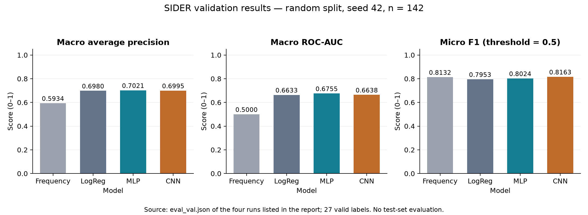
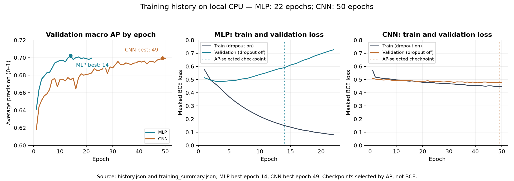

# Báo cáo kỹ thuật và kết quả thực nghiệm — ADR Predictor

**Dự án:** ADR Prediction Using MLP with Logistic Regression — dự đoán nhóm phản ứng có hại của thuốc bằng MLP và hàm hồi quy logistic

Project đã thực hiện được luồng tải dữ liệu → chuẩn bị phân tử → chia tập → train → đánh giá validation → dự đoán qua CLI và Streamlit. Bốn mô hình đã train là Frequency, Logistic Regression, MLP và CNN. MLP đạt macro AP validation cao nhất trong lần chạy hiện tại; CNN đạt micro F1 cao nhất ở ngưỡng 0,5. Các kết quả này thuộc **random split, seed 42**, chưa phải kết quả trên test và chưa phải kết quả training với scaffold split.

**Mục lục hai phần lớn**

- [Phần I — Cấu trúc dự án, xử lý cấu trúc phân tử và quy trình thực hiện](#phan-i)
- [Phần II — Kết quả thực nghiệm, phân tích và hướng hoàn thiện](#phan-ii)

## PHẦN I — CẤU TRÚC DỰ ÁN, XỬ LÝ CẤU TRÚC PHÂN TỬ VÀ QUY TRÌNH THỰC HIỆN

Phần này giải thích dự án giải quyết bài toán gì, scaffold được hiểu và cấu hình ra sao, dữ liệu đi qua những file nào, mô hình được train tại đâu và cách tái hiện toàn bộ luồng chạy.

### 1.1. Bài toán và những khái niệm cần phân biệt

Đầu vào là **SMILES**, một chuỗi ký tự biểu diễn cấu trúc phân tử. Đầu ra là **27 điểm tương ứng 27 nhóm nhãn ADR MedDRA trong benchmark SIDER MoleculeNet**. Mỗi phân tử có thể có nhiều nhãn cùng lúc, vì vậy đây là **phân loại đa nhãn** (*multi-label classification*).

Một vector mục tiêu minh họa có thể là `[1, 0, 1, ...]`: phân tử có nhãn thứ nhất và thứ ba theo dữ liệu nguồn. Đây là ví dụ về định dạng, không phải kết luận y khoa về một thuốc cụ thể.

| Khái niệm | Nghĩa trong project |
|---|---|
| Đặc trưng đầu vào | Morgan fingerprint đối với LogReg/MLP; token ký tự SMILES đối với CNN. |
| Nhãn đầu ra | 27 nhóm ADR theo đúng tên và thứ tự cột nguồn. |
| Logit | Giá trị thô mô hình neural trả ra trước sigmoid. |
| Score | Điểm trong khoảng 0–1 dùng để xếp hạng nhãn hoặc so với ngưỡng. |
| Threshold | Ngưỡng tạo nhãn dự đoán; hiện là 0,5 cho mọi nhãn. |
| Epoch | Một lượt neural model đi qua toàn bộ tập train. |
| Checkpoint | Bộ trọng số được lưu để dùng lại; project chọn checkpoint theo validation macro AP. |
| Artifact | Các file máy cần để nạp model, kiểm chứng dữ liệu và tái lập run. Báo cáo này diễn giải các file đó cho người đọc. |

MLP và CNN là kiến trúc có thể dùng cho nhiều loại bài toán. Trong project này chúng có 27 đầu ra, học bằng binary cross-entropy và áp sigmoid khi dự đoán, nên được sử dụng cho **phân loại**, không phải hồi quy đại lượng liên tục. Tên *Logistic Regression* cũng không làm bài toán hiện tại trở thành hồi quy.

Các score chưa được hiệu chỉnh thành xác suất nguy cơ ở bệnh nhân. Nhãn 0 không chứng minh thuốc an toàn; nhãn benchmark và kết quả dự đoán không được dùng như quyết định lâm sàng. Các nhóm đầu ra có phạm vi rộng, không phải 27 triệu chứng cụ thể.

### 1.2. Scaffold phần mềm: cách tổ chức các folder và file

Từ **scaffold** có hai nghĩa trong phạm vi báo cáo: **khung cấu trúc phần mềm** được trình bày ở mục này và **khung hóa học Bemis–Murcko để chia dữ liệu** ở mục 1.5. Hai khái niệm có chức năng khác nhau.

```text
ADR_Product/
├── pyproject.toml                 Khai báo package adr, dependency và pytest
├── requirements.txt               Cài package editable và pytest
├── requirements-tested.txt        Các phiên bản đã kiểm chứng trên máy hiện tại
├── setup.ps1                      Thiết lập môi trường Windows
├── run.ps1                        Khởi động demo Streamlit
├── README.md                      Hướng dẫn vận hành ngắn
├── .gitignore                     Loại môi trường, dữ liệu/model sinh ra khỏi Git
├── configs/                       Cấu hình nền và cấu hình từng model
├── src/adr/                       Mã nguồn chính theo từng công đoạn
│   ├── config.py                  Load/deep-merge YAML, resolve đường dẫn
│   ├── schemas.py                 Hợp đồng metadata và kết quả dự đoán
│   ├── data/                      Download, validate, prepare, split, load
│   ├── features/                  Morgan fingerprint và char tokenizer
│   ├── models/                    Frequency, LogReg, MLP, CNN
│   ├── train/                     Trainer baseline, trainer neural, loss
│   ├── evaluate/                  Metric và runner đánh giá
│   ├── predict/                   Predictor dùng chung và CLI inference
│   └── utils/                     Seed, checksum, run_id và kiểm tra artifact
├── data/
│   ├── raw/                       Dữ liệu nguồn đã tải/giải nén
│   ├── processed/                 Dữ liệu chuẩn hóa và mask
│   └── splits/                    Manifest random split đang dùng
├── artifacts/                     Model và bằng chứng của từng run
├── results/                       Tổng hợp metric và gói mã nguồn Colab
├── app/streamlit_app.py            Giao diện dự đoán cho người dùng
├── scripts/                       Pipeline một lệnh, smoke test, export Colab
├── notebooks/                     EDA và notebook hướng dẫn train Colab
├── tests/                         Unit test và regression/integration test
├── reports/                       Báo cáo kỹ thuật và kết quả thực nghiệm
│   └── images/                    Hình minh họa training và validation
├── .venv/                         Môi trường Python đang sử dụng
└── .work/                         Log kiểm tra và dữ liệu thử nội bộ
```

`reports/` chứa báo cáo này và các hình trong `images/`. Roadmap cũ và đề cương rỗng đã được bỏ vì nội dung hiện tại được trình bày trong báo cáo. Tài liệu giải thích ban đầu đã chuyển ra [thư mục Project1](../../giải_thích.md). `.venv/` và `.work/` phục vụ môi trường và kiểm tra.

Những file trực tiếp tham gia luồng chạy được phân công như sau:

| File | Trách nhiệm và đầu ra chính |
|---|---|
| `src/adr/data/download.py` | Tải CSV nén từ S3, ghi thời điểm/checksum nguồn, giải nén CSV. Download mới dùng file `.part` trước khi thay vào đích. |
| `src/adr/data/validate.py` | Kiểm tra cột SMILES, số nhãn, giá trị 0/1/NaN, phân tử lỗi và bản ghi trùng/mâu thuẫn. |
| `src/adr/data/prepare.py` | Canonicalize, tạo `drug_id`, gộp bản ghi trùng hợp lệ, lưu dữ liệu và mask. |
| `src/adr/data/split.py` | Tạo manifest random hoặc scaffold, ghi số mẫu và cấu hình chia tập. |
| `src/adr/data/load.py` | Đọc một split, căn đúng thứ tự mẫu với nhãn và mask; từ chối manifest sai hoặc ID trùng. |
| `src/adr/features/fingerprints.py` | Tạo Morgan fingerprint và lưu cấu hình đặc trưng. |
| `src/adr/features/tokenizer.py` | Fit vocabulary từ train, encode, pad/truncate và thống kê UNK. |
| `src/adr/train/baseline.py` | Fit Frequency hoặc 27 bộ phân loại Logistic Regression, lưu artifact. |
| `src/adr/train/neural.py` | Train MLP/CNN, đánh giá validation theo epoch, early stopping và resume. |
| `src/adr/train/losses.py` | Masked binary cross-entropy with logits, bỏ vị trí nhãn chưa quan sát. |
| `src/adr/evaluate/metrics.py` | AP, ROC-AUC, precision/recall/F1 và chính sách metric không xác định. |
| `src/adr/evaluate/run.py` | Nạp artifact, kiểm tra checksum/nhãn, đánh giá split được yêu cầu. |
| `src/adr/predict/predictor.py` | Chuẩn hóa input, nạp đúng model/features và trả kết quả thống nhất cho app/CLI. |
| `src/adr/predict/run.py` | Giao diện dòng lệnh cho một SMILES hoặc file chứa nhiều SMILES. |
| `app/streamlit_app.py` | Tự nạp model, ưu tiên MLP; nhận SMILES qua form Submit và hiển thị bảng top 5. |
| `scripts/run_pipeline.py` | Ghép download → prepare → split → train → evaluate validation. |
| `scripts/smoke.py` | Kiểm tra kỹ thuật offline bằng dữ liệu tổng hợp. |
| `scripts/export_colab.py` | Gói mã nguồn dùng trên Colab; bỏ môi trường, dữ liệu và model cục bộ. |

Notebook EDA không nắm giữ logic cốt lõi của pipeline. Điều này cho phép train, evaluate và dự đoán bằng CLI mà không cần chạy thủ công một chuỗi cell EDA.

### 1.3. Cấu hình và môi trường thực tế

`src/adr/config.py` đọc `configs/base.yaml`, sau đó **deep-merge** cấu hình model lên cấu hình nền. Khi một model chỉ thay một khóa con, các khóa con còn lại được giữ nguyên. Ví dụ, thay `model.dropout` không làm mất cấu hình đường dẫn hoặc seed. `resolve_paths()` chuyển các đường dẫn tương đối thành đường dẫn tuyệt đối theo gốc project. Cấu hình đã giải quyết được lưu vào từng run để truy vết thực nghiệm.

Các giá trị nền đang dùng:

```yaml
project:
  seed: 42
paths:
  data_raw: data/raw
  data_processed: data/processed
  data_splits: data/splits
  artifacts: artifacts
  results: results
data:
  num_labels: 27
split:
  strategy: random
  seed: 42
  train_ratio: 0.80
  val_ratio: 0.10
  test_ratio: 0.10
features:
  fingerprint:
    radius: 2
    n_bits: 2048
    use_chirality: true
training:
  batch_size: 32
  max_epochs: 50
  learning_rate: 0.001
  early_stopping_patience: 8
  optimizer: adam
  loss: bce_with_logits
  checkpoint_metric: macro_ap
inference:
  threshold: 0.5
```

`configs/frequency.yaml`, `logreg.yaml`, `mlp.yaml`, `cnn.yaml` chọn model và bổ sung tham số riêng. Với CNN, `features.tokenizer.max_length=512` là mức trần; chiều dài thực tế bằng giá trị nhỏ hơn giữa chuỗi dài nhất trong train và mức trần này.

Training đã thực hiện **trên máy Windows chứa project, bằng CPU**, không phải trên Colab hay GPU. Môi trường chạy là `.venv/Scripts/python.exe`; virtual environment hiện có `include-system-site-packages=true`, nên kế thừa thư viện đã cài trên máy. Đây là môi trường đã chạy thành công, nhưng không phải một môi trường hoàn toàn độc lập với Python hệ thống.

| Thành phần | Phiên bản ghi trong metadata của run |
| --- | --- |
| Python | 3.14.7 |
| NumPy | 2.5.3 |
| pandas | 3.0.6 |
| scikit-learn | 1.9.1 |
| PyTorch | 2.14.1+cpu |
| RDKit | 2026.09.1 |
| PyYAML | 6.0.3 |
| Streamlit | 1.66.0 |

PyTorch báo bản CPU; metadata và training summary ghi thiết bị `cpu`. Trainer neural mặc định dùng 4 CPU thread qua `training.num_threads` nếu cấu hình không ghi đè. Project yêu cầu Python ≥3.10 ở mức khai báo package; tổ hợp đã được kiểm chứng thực tế trong báo cáo là các phiên bản ở bảng trên. `requirements-tested.txt` ghi phiên bản thư viện chính, không phải lock toàn bộ dependency bắc cầu.

### 1.4. Dữ liệu nguồn và cách xử lý cấu trúc phân tử

Dữ liệu được tải từ [SIDER CSV do DeepChem phân phối](https://deepchemdata.s3-us-west-1.amazonaws.com/datasets/sider.csv.gz). File nén đã tải có kích thước **34.759 byte**, gồm **1.427 mẫu và 27 cột nhãn** sau khi đọc CSV. `data/raw/download_meta.json` lưu URL, thời gian UTC, kích thước và SHA-256 để nhận diện đúng phiên bản tải về.

Luồng chuẩn bị dữ liệu trong `prepare.py`:

1. **Validate schema:** phải có `smiles`; nhãn chỉ chứa 0, 1 hoặc NaN; số nhãn phải bằng 27. Tên/thứ tự nhãn lấy từ các cột nguồn, không tự sắp xếp lại.
2. **Parse phân tử bằng RDKit:** SMILES không parse được hoặc không chứa nguyên tử được coi là lỗi. Hàng lỗi được loại và có báo cáo; nếu không còn hàng hợp lệ, chương trình dừng.
3. **Canonicalize:** dùng `Chem.MolToSmiles(..., isomericSmiles=True)` tạo biểu diễn chuẩn có thông tin lập thể. Ví dụ về chuẩn hóa định dạng: `CCO` và `OCC` có thể quy về cùng một cấu trúc chuẩn.
4. **Tạo ID:** `drug_id = SHA256(canonical_smiles)`. Đây là mã hex đầy đủ để định danh phân tử, không phải Morgan fingerprint và không phải hàm `hash()` phụ thuộc phiên chạy của Python.
5. **Xử lý trùng:** các hàng cùng canonical SMILES chỉ được gộp khi nhãn và trạng thái missing giống nhau. Nếu chúng mâu thuẫn, pipeline dừng để tránh tự quyết định nhãn không có căn cứ.
6. **Tách mask:** nhãn NaN được ghi giá trị đệm 0 trong CSV, đồng thời `label_mask.npy` ghi `False` tại vị trí đó. Loss/metric dựa vào mask để không coi giá trị đệm là nhãn âm thật.
7. **Lưu các file liên kết:** CSV, tên nhãn, mapping hàng nguồn và mask có cùng thứ tự mẫu.

| File tạo ra | Nội dung và nơi sử dụng |
|---|---|
| `data/raw/sider.csv.gz` | Bản nén tải từ nguồn, làm căn cứ nguồn dữ liệu. |
| `data/raw/sider.csv` | CSV đầu vào của validation/prepare. |
| `data/raw/download_meta.json` | URL, thời gian tải và checksum bản nén. |
| `data/processed/processed.csv` | `drug_id`, SMILES gốc, canonical SMILES và 27 nhãn; dùng khi train/evaluate. |
| `data/processed/label_names.json` | Thứ tự và tên chính xác của 27 đầu ra. |
| `data/processed/label_mask.npy` | Ma trận mask `[1427, 27]`; căn cùng hàng với processed CSV. |
| `data/processed/drug_id_mapping.json` | Ánh xạ từ drug_id về các hàng nguồn, hỗ trợ truy vết việc gộp trùng. |
| `data/processed/smiles_errors.json` | Chỉ phát sinh khi có hàng SMILES lỗi cần ghi lại. |

**Phạm vi chuẩn hóa hiện tại:** code canonicalize biểu diễn SMILES và giữ lập thể. Code chưa có quy trình chuẩn hóa tautomer, trung hòa điện tích, chọn mảnh muối lớn nhất, tối ưu cấu trúc 3D hay tạo conformer. Vì vậy không nên mô tả project là đã thực hiện các bước chuẩn hóa hóa học đó. Chuỗi nhiều thành phần có thể vẫn giữ dấu `.` theo kết quả RDKit.

### 1.5. Random split và scaffold split được cấu hình như thế nào

#### 1.5.1. Random split — phương án đã dùng để train

`random_split()` hoán vị danh sách drug_id bằng bộ sinh số ngẫu nhiên NumPy với seed 42, lấy phần đầu làm train, phần tiếp làm validation và phần còn lại làm test. Sau prepare, mỗi drug_id chỉ xuất hiện ở một hàng; loader còn kiểm tra lại ID trùng và tập ID của manifest.

Với 1.427 mẫu và tỷ lệ 0,8/0,1/0,1, code lấy phần nguyên cho train và validation: **1.141 train, 142 validation, 144 test**. Số test nhận phần dư nên không bằng số validation.

`data/splits/split_manifest.csv` lưu hai cột `drug_id,split`; `split_meta.json` lưu chiến lược, seed, tỷ lệ và số mẫu. Trainer/evaluator đọc manifest, không tự chia lại dữ liệu trong mỗi epoch.

Không có cùng drug_id ở hai split. Tuy nhiên, **các phân tử khác nhau có thể cùng khung hóa học**, nên random split không bảo đảm scaffold tách biệt.

#### 1.5.2. Scaffold split — phương án đã triển khai và kiểm tra

Scaffold trong mục này là **khung Bemis–Murcko**, được tính từ phân tử RDKit bằng `MurckoScaffold.MurckoScaffoldSmiles(..., includeChirality=False)`. Cùng scaffold được giữ nguyên trong một split nhằm tạo một phép kiểm tra khó hơn về khả năng dự đoán trên khung hóa học chưa có trong train. Đây cũng là động cơ dùng scaffold split trong benchmark [MoleculeNet](https://arxiv.org/html/1703.00564v3).

Thuật toán cụ thể của project:

1. Nhận drug_id cùng canonical SMILES tương ứng và kiểm tra tỷ lệ hợp lệ.
2. Tính scaffold cho từng phân tử; nhóm drug_id theo scaffold.
3. Sắp khóa scaffold để có điểm xuất phát ổn định, shuffle các nhóm với seed đã chọn rồi sắp theo kích thước giảm dần. Shuffle ảnh hưởng thứ tự giữa những nhóm bằng kích thước.
4. Tính số mẫu mục tiêu cho train/val/test từ các tỷ lệ.
5. Với từng nhóm, đưa toàn bộ nhóm vào split có **số mẫu còn thiếu so với mục tiêu lớn nhất**. Không cắt một nhóm scaffold để ép vừa tỷ lệ.
6. Yêu cầu cuối cùng có đủ ba split; nếu quá ít nhóm hoặc phân bổ không tạo đủ ba tập, chương trình báo lỗi.

Vì giữ nguyên nhóm, tỷ lệ thực tế chỉ xấp xỉ tỷ lệ cấu hình. Phân tử không có khung vòng tạo scaffold rỗng `""`; code đang gom **tất cả các phân tử scaffold rỗng vào cùng một nhóm**, không chia ngẫu nhiên từng phân tử đó. Đây là lựa chọn thuật toán cần ghi rõ vì nhóm này khá lớn trong dữ liệu hiện tại.

Trong lần kiểm tra đã có, manifest scaffold tạm được lưu tại `.work/scaffold_splits/split_manifest.csv`: **1.141 train, 143 validation, 143 test** và không có scaffold giao nhau giữa các cặp split. Manifest chính trong `data/splits/` vẫn là random; không lấy số liệu validation random để gọi thành kết quả scaffold.

Trong manifest scaffold kiểm tra này, toàn bộ **154 phân tử có scaffold rỗng nằm ở train**. Ở random split, cùng nhóm được phân tán thành 122 train, 18 validation và 14 test. Điều này minh họa trực tiếp tác động của việc giữ nguyên nhóm trong scaffold split.

#### 1.5.3. Cách thử scaffold mà giữ nguyên split của các run đã có

Nếu chạy trực tiếp lệnh split scaffold với config mặc định, manifest trong `data/splits/` sẽ bị thay. Evaluator của các run random sau đó sẽ phát hiện checksum không khớp. Để giữ được dữ liệu thực nghiệm cũ, hãy tạo một cấu hình nền đầy đủ sử dụng đường dẫn split riêng.

Các lệnh dưới đây là **hướng dẫn cho thực nghiệm tiếp theo**, chưa được dùng để tạo bảng metric của báo cáo:

```powershell
cd D:\HUST_20261\Project1\ADR_Product

@'
from pathlib import Path
import yaml
from adr.config import load_config

cfg = load_config()
cfg["split"]["strategy"] = "scaffold"
cfg["paths"]["data_splits"] = "data/splits_scaffold"
Path("configs/scaffold_base.yaml").write_text(
    yaml.safe_dump(cfg, sort_keys=False), encoding="utf-8"
)
'@ | .\.venv\Scripts\python.exe -

.\.venv\Scripts\python.exe -m adr.data.split --config configs/scaffold_base.yaml --strategy scaffold
.\.venv\Scripts\python.exe -m adr.train.baseline --config configs/logreg.yaml --base configs/scaffold_base.yaml
.\.venv\Scripts\python.exe -m adr.train.neural --config configs/mlp.yaml --base configs/scaffold_base.yaml --device cpu
.\.venv\Scripts\python.exe -m adr.train.neural --config configs/cnn.yaml --base configs/scaffold_base.yaml --device cpu
```

Cấu hình mới giữ nguyên đường dẫn dữ liệu processed và artifact; mỗi trainer tạo run_id mới nên không ghi đè model cũ. Hãy ghi nhận run_id mới khi evaluate và kiểm tra `config.yaml`/`metadata.json` để nhận diện đúng chiến lược. Báo cáo này **không tự thực hiện** các lệnh training scaffold trên.

### 1.6. Cấu trúc phân tử được biến thành đầu vào model như thế nào

#### 1.6.1. Nhánh Morgan fingerprint cho LogReg và MLP

Canonical SMILES được RDKit parse thành đồ thị phân tử. `MorganFeaturizer` dùng `rdFingerprintGenerator.GetMorganGenerator` với **radius 2, 2.048 bit, includeChirality=True**.

Morgan fingerprint mã hóa các môi trường nguyên tử lân cận thành vector bit có chiều cố định. Radius 2 thường được gọi theo kiểu ECFP4 vì đường kính môi trường là 4 liên kết. Chỉ số bit là kết quả ánh xạ đặc trưng vào không gian hữu hạn; có thể có va chạm bit. Mỗi bit không tương ứng một nhóm ADR.

Luồng dữ liệu:

```text
canonical SMILES
    → RDKit molecule (nguyên tử, liên kết, thông tin lập thể)
    → Morgan fingerprint: 2.048 bit
    → vector float32 gồm các giá trị 0/1
    → ma trận train [1141, 2048]
    → LogReg hoặc MLP
```

Feature config được lưu trong `fingerprint_config.json` và kiểm tra khi nạp model. Fingerprint là phép biến đổi xác định; không fit từ validation/test. Code hiện không thêm chuẩn hóa z-score hay augmentation cho các bit này. Khi có SMILES lỗi trong dữ liệu training đã chuẩn bị, trainer dừng thay vì tiếp tục fit bằng hàng đặc trưng lỗi.

#### 1.6.2. Nhánh token ký tự cho CNN

`CharTokenizer.fit()` chỉ nhìn canonical SMILES của **tập train**, gom các ký tự và gán ID theo thứ tự sắp xếp. Hai ID đặc biệt là `PAD=0` và `UNK=1`. Validation và inference dùng lại đúng vocabulary đã lưu, không fit thêm.

Artifact hiện tại có **55 token**, gồm hai token đặc biệt. Chuỗi dài nhất trong train có **1.321 ký tự**, nhưng giới hạn config là 512 nên input dùng chiều dài **512**. Chuỗi ngắn hơn được thêm PAD ở cuối; chuỗi dài hơn bị cắt. Attention mask đánh dấu vị trí ký tự thật.

Đây là tokenizer **theo ký tự**, không phải tokenizer theo nguyên tử: chẳng hạn chuỗi ký hiệu `Cl` được tách thành `C` và `l`. CNN phải học các mẫu ký tự liên quan đến cú pháp SMILES; code chưa dùng graph neural network hay SMILES Transformer.

```text
canonical SMILES
    → ký tự → token ID
    → truncate/pad đến 512 vị trí
    → input_ids int64 [N, 512] + attention_mask bool [N, 512]
    → embedding → CNN → masked pooling
```

Trên dữ liệu đã chạy, train có **16/1.141 chuỗi bị cắt**, validation có **3/142 chuỗi bị cắt**; cả hai tập có 0 ký tự UNK theo thống kê tokenizer. Việc cắt giúp giới hạn bộ nhớ nhưng làm mất phần cuối biểu diễn ở các phân tử dài; số liệu này cần được xem là một giới hạn của cấu hình CNN hiện tại.

### 1.7. Bốn mô hình được cấu trúc và sử dụng ra sao

#### 1.7.1. Frequency — mốc so sánh tần suất

`FrequencyBaseline` tính riêng cho mỗi nhãn j:

```text
score_j = số mẫu train có nhãn j = 1 và được quan sát
          ------------------------------------------------
          số mẫu train có nhãn j được quan sát
```

Mọi phân tử đầu vào nhận cùng vector 27 tần suất. Mô hình không dùng fingerprint/chuỗi SMILES để thay đổi điểm, dù Predictor vẫn validate input. Nó trả lời câu hỏi: **nếu chỉ biết mức phổ biến của từng nhãn, ta đạt được kết quả nào?**

Frequency không có quá trình tối ưu theo epoch. Nếu một nhãn không có bất kỳ quan sát train nào, model báo lỗi vì không thể tính tần suất. Trong dữ liệu hiện tại, tình huống đó không xảy ra.

#### 1.7.2. Logistic Regression — bộ phân loại riêng cho mỗi nhãn

`PerLabelLogReg` nhận fingerprint 2.048 chiều và fit **27 bộ LogisticRegression**, mỗi bộ dùng các hàng có quan sát cho nhãn tương ứng. Mỗi bộ tạo điểm dạng `sigmoid(w_j · fingerprint + b_j)`.

Cấu hình: **solver=lbfgs, C=1, max_iter=1000**. `max_iter` là giới hạn vòng lặp tối ưu của solver, không phải 1.000 epoch neural. Nếu nhãn train chỉ có một lớp, code dùng bộ dự đoán hằng; khi hoàn toàn không có quan sát, trainer báo lỗi và nêu tên nhãn thiếu dữ liệu. Run thực tế có đủ hai lớp cho cả 27 nhãn nên không dùng fallback.

Kiểm tra các estimator đã lưu cho thấy số vòng lặp thực tế từ **22 đến 48**, trung vị **37**. Vì vậy không nên viết “LogReg đã train 1.000 epoch”.

#### 1.7.3. MLP — mạng fully connected trên fingerprint

```text
Fingerprint [B, 2048]
    → Linear(2048, 256)
    → ReLU
    → Dropout(0.2)
    → Linear(256, 27)
    → logits [B, 27]
```

MLP có **531.483 tham số** trong cấu hình đã train. Không đặt sigmoid bên trong `forward()`; loss nhận logits trực tiếp để tính ổn định số học. Khi inference, sigmoid được áp sau forward.

`ReLU` giữ phần dương và đưa giá trị âm về 0, giúp mạng biểu diễn quan hệ phi tuyến. `Dropout(0.2)` tạm loại ngẫu nhiên khoảng 20% activation ở lớp đó trong lúc train để regularization; dropout được tắt khi evaluate/inference.

MLP học quan hệ phi tuyến giữa các bit cấu trúc và nhãn. Fingerprint đã cung cấp biểu diễn phân tử, còn mạng học cách kết hợp các bit để dự đoán ADR. Điều này giúp so sánh trực tiếp với LogReg ở cùng loại đặc trưng.

#### 1.7.4. CNN — mạng tích chập một nhánh trên SMILES

```text
input_ids [B, 512], attention_mask [B, 512]
    → Embedding(vocab_size=55, embedding_dim=64, padding_idx=0)
    → [B, 512, 64]
    → transpose → [B, 64, 512]
    → Conv1D(64 → 128, kernel_size=5, padding=2)
    → ReLU → [B, 128, 512]
    → masked mean pooling → [B, 128]
    → Dropout(0.2)
    → Linear(128, 27)
    → logits [B, 27]
```

CNN có **48.091 tham số**. Embedding ở vùng bị mask được loại trước convolution; masked mean pooling chỉ lấy trung bình trên vị trí token thật. Kernel được yêu cầu là số lẻ dương để giữ chiều dài theo cách padding hiện tại. Test kiểm tra đầu ra giữ nguyên khi chỉ thêm PAD cuối chuỗi.

Embedding biến mỗi ID ký tự thành vector 64 chiều có thể học. Kernel 5 xem xét các cửa sổ cục bộ gồm 5 vị trí; 128 kênh học các mẫu khác nhau trên chuỗi. Masked mean pooling gom các vị trí còn hiệu lực thành vector có kích thước cố định để lớp cuối tạo 27 đầu ra.

CNN hiện có ít tham số hơn MLP, nhưng xử lý chuỗi dài nên **không thể suy ra tốc độ train chỉ bằng số tham số hoặc tên model**. Mạng này tích chập trên chuỗi SMILES, không phải trực tiếp trên ảnh phân tử hay đồ thị liên kết.

### 1.8. Training neural diễn ra như thế nào

`src/adr/train/neural.py` thực hiện các bước sau cho MLP/CNN:

1. Load và resolve config; kiểm tra model, optimizer, loss và tham số training hợp lệ.
2. Cố định seed cho Python, NumPy và PyTorch; chọn CPU hoặc CUDA theo tùy chọn.
3. Đọc train/validation theo manifest và kiểm tra tương ứng ID–nhãn–mask. Không dùng test để chọn checkpoint.
4. Tạo fingerprint hoặc fit/load tokenizer. Gói input, target và mask vào `TensorDataset`/`DataLoader`.
5. Mỗi epoch shuffle train bằng generator có seed `project.seed + epoch`.
6. Với mỗi batch: zero gradient → forward → masked BCE → backward → Adam step. Batch không có nhãn quan sát hoặc loss không hữu hạn sẽ gây lỗi rõ ràng.
7. Chuyển sang `eval()` và tắt gradient để chạy validation; tính validation loss và macro AP.
8. Khi validation macro AP tăng, lưu `model.pt` làm checkpoint tốt nhất. Nếu không tăng 8 epoch liên tiếp, dừng sớm.
9. Lưu lịch sử và trạng thái optimizer/RNG sau epoch để có thể resume; không tự evaluate test.

Masked loss có dạng:

```text
L = Σ(i,j) mask[i,j] × BCEWithLogits(logit[i,j], target[i,j])
    -----------------------------------------------------
                   Σ(i,j) mask[i,j]
```

Những target bị mask được đặt giá trị an toàn trước khi tính BCE để tránh NaN lan vào loss. Trong bộ dữ liệu thật lần này mọi nhãn đều được quan sát, nhưng cơ chế mask vẫn được giữ và kiểm thử bằng dữ liệu tổng hợp có missing.

Với batch size 32: mỗi epoch có **36 batch train** (batch cuối nhỏ hơn) và **5 batch validation**. Optimizer là Adam, learning rate 0,001; code hiện chưa có learning-rate scheduler, class weighting hay tìm threshold riêng cho từng nhãn.

**Tiêu chí chọn model là macro AP, không phải validation loss nhỏ nhất.** Hai đại lượng đo các khía cạnh khác nhau; điều này quan trọng để hiểu đường cong MLP trong Phần II.

### 1.9. Train tại đâu, đã train bao nhiêu epoch và lưu run nào

Các run trong bảng kết quả đã được train trên CPU của máy Windows hiện tại, sử dụng cùng processed dataset và random manifest seed 42. Không có bằng chứng training GPU/Colab cho các run này. Notebook Colab là phương án đã chuẩn bị để chạy trong tương lai.

| Model | Run ID được báo cáo | Training thực tế | Checkpoint dùng inference | Lý do kết thúc |
| --- | --- | --- | --- | --- |
| Frequency | `frequency_20261018_062440_366755_42` | Một lần thống kê | Không có epoch | Hoàn thành thống kê |
| LogReg | `logreg_20261018_062023_976783_42` | 27 estimator; 22–48 vòng solver | Không có epoch neural | Hoàn thành fit |
| MLP | `mlp_20261018_062016_027728_42` | 22 epoch | Epoch 14 | Early stopping |
| CNN | `cnn_20261018_062016_027732_42` | 50 epoch | Epoch 49 | Đạt max_epochs=50 |

Giới hạn neural được cấu hình là **50 epoch** cho cả hai model:

- **MLP:** hoàn thành 22 epoch; điểm tốt nhất ở epoch 14; 8 epoch 15–22 không vượt điểm đó nên early stopping. Tổng số bước cập nhật optimizer là 22 × 36 = **792**.
- **CNN:** hoàn thành đủ 50 epoch; điểm tốt nhất ở epoch 49; dừng do chạm giới hạn 50, không phải early stopping. Tổng số bước cập nhật optimizer là 50 × 36 = **1.800**.
- **Frequency:** một lần thống kê tần suất, không có epoch.
- **LogReg:** 27 lần fit estimator với số vòng lặp solver như mục 1.7.2, không dùng vòng epoch neural.

`model.pt` dùng khi inference là **checkpoint tốt nhất**, vì vậy MLP đang dự đoán bằng trọng số epoch 14 và CNN bằng trọng số epoch 49. `training_state.pt` giữ trạng thái cuối epoch 22/50 để resume. Hai file có mục đích khác nhau.

### 1.10. Luồng chạy và lệnh tái hiện

#### 1.10.1. Luồng end-to-end

```text
SIDER từ nguồn công khai
    ↓ data/download.py
data/raw/sider.csv + download_meta.json
    ↓ data/validate.py + data/prepare.py
processed.csv + label_names.json + label_mask.npy + mapping
    ↓ data/split.py
split_manifest.csv + split_meta.json
    ↓ data/load.py
train / validation được căn đúng thứ tự ID và mask
    ├── Frequency: thống kê tần suất từ nhãn train
    ├── Morgan fingerprint → LogReg
    ├── Morgan fingerprint → MLP
    └── char tokenizer fit từ train → CNN
    ↓ train/baseline.py hoặc train/neural.py
artifacts/<run_id>/model + metadata + feature config
    ├── evaluate/run.py → eval_val.json
    └── predict/predictor.py → CLI hoặc Streamlit

test: giữ riêng; chỉ evaluate khi người thực hiện chủ động chốt cấu hình
```

#### 1.10.2. Thiết lập môi trường trên máy mới

```powershell
cd D:\HUST_20261\Project1\ADR_Product
python -m venv .venv
.\.venv\Scripts\python.exe -m pip install --upgrade pip
.\.venv\Scripts\python.exe -m pip install -r requirements.txt
```

Có thể thay bằng `setup.ps1`. Các lệnh gọi trực tiếp Python của `.venv` không yêu cầu kích hoạt virtual environment trong PowerShell. Máy hiện tại đã có môi trường và model nên không cần cài/train lại chỉ để xem demo.

#### 1.10.3. Tải, chuẩn bị, chia random và train

```powershell
.\.venv\Scripts\python.exe -m adr.data.download --config configs/base.yaml
.\.venv\Scripts\python.exe -m adr.data.prepare --config configs/base.yaml
.\.venv\Scripts\python.exe -m adr.data.split --config configs/base.yaml --strategy random

.\.venv\Scripts\python.exe -m adr.train.baseline --config configs/frequency.yaml
.\.venv\Scripts\python.exe -m adr.train.baseline --config configs/logreg.yaml
.\.venv\Scripts\python.exe -m adr.train.neural --config configs/mlp.yaml --device cpu
.\.venv\Scripts\python.exe -m adr.train.neural --config configs/cnn.yaml --device cpu
```

Hoặc ghép bằng script:

```powershell
.\.venv\Scripts\python.exe scripts/run_pipeline.py --models frequency logreg mlp cnn --device cpu
```

Script một lệnh tạo lại processed/split trước khi train và ghi `results/run_summary.json` cho **những model được chọn trong lần gọi đó**. Đây là file tổng hợp có thể bị ghi lại; bằng chứng chi tiết theo run vẫn nằm trong `artifacts/<run_id>/`. Chạy `--epochs 2` là một lần kiểm tra ngắn, không tương đương các run 22/50 epoch của báo cáo.

#### 1.10.4. Evaluate validation và dự đoán với model đã có

```powershell
.\.venv\Scripts\python.exe -m adr.evaluate.run --run-dir artifacts/mlp_20261018_062016_027728_42 --split val
.\.venv\Scripts\python.exe -m adr.predict.run --run-dir artifacts/mlp_20261018_062016_027728_42 --smiles "CC(=O)Nc1ccc(O)cc1"
.\run.ps1
```

App mở tại `http://127.0.0.1:8501`. Người dùng chọn **một** run model, nhập SMILES và bấm dự đoán; app không đòi chạy Frequency → LogReg → MLP → CNN theo thứ tự. Nếu có artifact, `run.ps1` dùng model đã lưu; nếu không có metadata model trực tiếp trong `artifacts/`, script chạy pipeline LogReg để tạo model đầu tiên.

`Predictor` nạp file theo model type, kiểm tra kích thước/feature config, canonicalize input rồi tạo 27 score. CLI và Streamlit dùng cùng Predictor. Với neural, model chạy `eval()` và `torch.inference_mode()`, áp sigmoid lên logits. Score ≥0,5 tạo nhãn dự đoán; top 5 chỉ là năm nhãn có điểm cao nhất. CNN báo khi input có UNK hoặc bị cắt; app báo SMILES sai thay vì coi đó là dự đoán hợp lệ.

#### 1.10.5. Resume training và khóa đánh giá test

```powershell
.\.venv\Scripts\python.exe -m adr.train.neural --config configs/cnn.yaml --resume artifacts/cnn_20261018_062016_027732_42 --epochs 80 --device cpu
```

`--epochs 80` nghĩa là tổng giới hạn 80 epoch, không phải cộng thêm 80. Resume đọc optimizer, trọng số cuối, RNG và lịch sử; từ chối nếu dataset, split, mask, seed, model/features hoặc các tham số training chính không tương thích. MLP đã đủ số epoch không cải thiện để early stop, nên resume cùng cấu hình không tự bỏ qua điều kiện dừng đó; muốn thử một cấu hình khác nên tạo run mới.

Tập test hiện chưa được đánh giá trong các run thật của báo cáo. Khi đã chọn xong toàn bộ cấu hình bằng validation, người thực hiện có thể chủ động chạy:

```powershell
.\.venv\Scripts\python.exe -m adr.evaluate.run --run-dir artifacts/mlp_20261018_062016_027728_42 --split test --lock-config
```

`--lock-config` ghi cờ chốt cấu hình vào metadata. Đây là **hàng rào theo quy trình**, không phải cơ chế mật mã hay giới hạn kỹ thuật khiến test chỉ có thể chạy một lần. Người thực hiện vẫn cần tuân thủ nguyên tắc không điều chỉnh mô hình theo kết quả test. Lệnh test trên chỉ được minh họa trong báo cáo, không được thực thi khi xuất báo cáo.

#### 1.10.6. Nếu muốn training trên Colab

```powershell
.\.venv\Scripts\python.exe scripts/export_colab.py
```

Lệnh tạo `results/ADR_Product_colab.zip`, chỉ gồm mã nguồn/cấu hình/notebook cần thiết. Sau đó mở `notebooks/02_train_colab.ipynb` trên Google Colab, chọn runtime có GPU nếu khả dụng, upload ZIP và chạy các cell theo thứ tự. Notebook cài package, tải/chuẩn bị SIDER và train MLP/CNN bằng `--device auto`; khi không có CUDA, trainer dùng CPU. Cuối notebook có bước tải ZIP chứa `artifacts/` về máy để dùng cho inference.

Phần notebook/GPU chưa được chạy kiểm chứng trong các thực nghiệm hiện có. [Colab FAQ](https://research.google.com/colaboratory/faq.html) nêu tài nguyên GPU và thời lượng runtime phụ thuộc khả dụng. Muốn evaluate model chuyển máy, cần mang đúng dữ liệu/split tương ứng và dùng `--base` để chỉ cấu hình đường dẫn phù hợp; inference chỉ cần bộ artifact đầy đủ.

### 1.11. Artifact gồm những gì và mỗi file dùng vào lúc nào

| File trong một run | Model liên quan | Mục đích |
|---|---|---|
| `model.json` | Frequency | 27 tỷ lệ dương, số nhãn và tên nhãn. |
| `model.pkl` | LogReg | Các estimator đã fit và thông tin model. |
| `model.pt` | MLP/CNN | State dict và cấu hình mạng của checkpoint tốt nhất để inference. |
| `fingerprint_config.json` | LogReg/MLP | Radius, số bit, chirality; bảo đảm đặc trưng khi inference khớp training. |
| `tokenizer.json` | CNN | Vocabulary, PAD/UNK và chiều dài encode; không cần fit lại. |
| `metadata.json` | Cả bốn | Run ID, seed, nhãn, threshold, phiên bản thư viện, checksum và resolved config. |
| `config.yaml` | Cả bốn | Bản cấu hình dùng cho run, thuận tiện tra cứu. |
| `history.json` | MLP/CNN | Train loss, val loss và val macro AP theo epoch. |
| `training_state.pt` | MLP/CNN | Trạng thái epoch cuối cùng, optimizer, RNG và lịch sử để resume. |
| `training_summary.json` | MLP/CNN | Epoch tốt nhất, tổng epoch đã chạy, AP tốt nhất và thiết bị. |
| `eval_val.json` | Cả bốn run được báo cáo | Metric tổng hợp và metric riêng 27 nhãn trên validation. |
| `eval_test.json` | Chỉ khi chủ động evaluate test | Hiện chưa có ở bốn run được báo cáo. |

Artifact checker yêu cầu có đủ file cần thiết theo từng model type. Evaluator còn so SHA-256 của processed CSV, manifest và mask, đồng thời kiểm tra thứ tự tên nhãn; dữ liệu thay đổi sẽ gây lỗi thay vì tính metric trên một tập khác mà người đọc không biết.

Không nên suy ra model đã sẵn sàng chỉ từ một file `.pt`: cần đúng metadata và bộ đặc trưng/tokenizer tương ứng. Ngược lại, không cần đọc artifact bằng tay để sử dụng app; Predictor đảm nhiệm việc nạp chúng.

### 1.12. Các phần đã hoàn thiện và cách kiểm tra

Những phần được bổ sung/sửa để luồng chạy được gồm: thay API Morgan fingerprint không import được; xử lý Path khi lưu metadata JSON; phát triển trainer MLP/CNN; nối neural checkpoint với inference/evaluation; bổ sung scaffold split; kiểm tra manifest/checksum; xử lý input rỗng và missing label; thêm script setup/run/pipeline và notebook Colab.

Các lệnh kiểm tra kỹ thuật:

```powershell
.\.venv\Scripts\python.exe -m pytest -q
.\.venv\Scripts\python.exe scripts/smoke.py
```

Test kỹ thuật xác nhận mã chạy đúng hợp đồng và các đường đi đã kiểm tra; nó không chứng minh mô hình dự đoán tốt ngoài benchmark. Kết quả kiểm tra thực tế được phân biệt với metric học máy trong Phần II.

<a id="phan-ii"></a>

## PHẦN II — KẾT QUẢ THỰC NGHIỆM, PHÂN TÍCH VÀ HƯỚNG HOÀN THIỆN

Phần này trình bày số liệu lấy từ các run thật, giải thích điểm mạnh/yếu của từng mô hình, phân tích đường cong training, ảnh hưởng mất cân bằng nhãn và giới hạn của random split. Các đề xuất cuối phần là hướng làm tiếp, không được trình bày như kết quả đã hoàn thành.

### 2.1. Kết quả chuẩn bị dữ liệu và chia tập

| Hạng mục đã kiểm tra | Kết quả |
|---|---:|
| Số hàng raw | 1.427 |
| Số phân tử processed | 1.427 |
| Số nhãn | 27 |
| SMILES lỗi trong bản raw hiện tại | 0 |
| Cột có giá trị nhãn ngoài 0/1/NaN | 0 |
| Nhóm trùng cùng nhãn cần gộp | 0 |
| Nhóm trùng mâu thuẫn nhãn | 0 |
| Drug ID trùng sau prepare | 0 |
| Vị trí nhãn bị missing | 0 trên 38.529 vị trí |
| Random train / validation / test | 1.141 / 142 / 144 |
| Drug ID giao nhau giữa các split | 0 |

Không có hàng bị loại trong dữ liệu thật lần này, vì vậy số phân tử trước và sau xử lý bằng nhau. Nhãn missing hiện không có trong SIDER CSV đã tải; cơ chế mask tồn tại để bảo toàn hợp đồng dữ liệu và đã được kiểm tra với fixture có missing.

**Phạm vi thực nghiệm:** một random split seed 42; một lần fit cho mỗi cấu hình được chọn trong bảng. Có thêm một run Frequency trước đó và các artifact smoke, nhưng không gộp chúng thành nhiều lần lặp hay dùng để tính độ lệch chuẩn. Frequency trong báo cáo là run được `results/run_summary.json` tham chiếu.

### 2.2. Các metric được sử dụng và cách đọc

**Macro AP — tiêu chí chính:** với từng nhãn, xếp các phân tử theo score rồi tính `average_precision_score`; lấy trung bình trên nhãn hợp lệ. AP đánh giá xếp hạng mẫu dương và không cần chọn threshold 0,5. Một nhãn phổ biến tự nhiên có baseline AP cao hơn một nhãn hiếm. AP ở đây không được thay bằng diện tích PR tính theo quy tắc hình thang.

**Macro ROC-AUC:** trung bình ROC-AUC theo nhãn, đánh giá thứ tự mẫu dương/âm trong từng nhãn. Điểm 0,5 biểu thị xếp hạng không phân biệt theo metric này. Không tính ROC-AUC cho nhãn chỉ có một lớp trong split.

**Micro precision/recall/F1:** gộp mọi cặp phân tử–nhãn quan sát được sau khi so threshold 0,5, rồi tính metric. Những nhãn có nhiều positive ảnh hưởng mạnh đến kết quả gộp. Đây là góc nhìn khác với việc cho mỗi nhãn một trọng số như nhau trong macro AP.

Nhãn không có positive nhận AP không xác định (`null`); nhãn không có cả hai lớp nhận ROC-AUC không xác định. Code bỏ giá trị không xác định khi lấy trung bình, không thay bằng 0. Ở validation hiện tại, cả **27/27 nhãn** đều có positive và negative nên cả AP lẫn ROC-AUC đều hợp lệ cho đủ 27 nhãn.

`macro AP = 0,7021` không có nghĩa accuracy 70,21%; `score = 0,8` cũng không phải nguy cơ 80% ở bệnh nhân. Báo cáo không đưa ra accuracy vì đó không phải metric được dùng trong pipeline hiện tại.

### 2.3. Kết quả tổng hợp trên validation

**Điều kiện chung:** random split seed 42, 142 mẫu validation, đủ 27 nhãn hợp lệ, threshold 0,5 cho các metric nhị phân; các neural metric được tính từ checkpoint tốt nhất theo macro AP.

| Model | Macro AP | Macro ROC-AUC | Micro precision | Micro recall | Micro F1 |
| --- | --- | --- | --- | --- | --- |
| Frequency | 0,5934 | 0,5000 | 0,7494 | **0,8888** | 0,8132 |
| LogReg | 0,6980 | 0,6633 | 0,7906 | 0,8000 | 0,7953 |
| MLP | **0,7021** | **0,6755** | **0,7982** | 0,8066 | 0,8024 |
| CNN | 0,6995 | 0,6638 | 0,7806 | 0,8554 | **0,8163** |



*Hình 1. So sánh macro AP, macro ROC-AUC và micro F1. Trục điểm bắt đầu từ 0 để thể hiện đúng quy mô chênh lệch. Nguồn: `eval_val.json` của bốn run trong mục 1.9; không dùng tập test.*

Những điều số liệu cho phép kết luận:

- **MLP đứng đầu macro AP và macro ROC-AUC** trong lần chạy này.
- **CNN đứng đầu micro F1**, với recall cao hơn MLP ở threshold chung 0,5.
- **LogReg rất gần hai neural model về macro AP**, nên là baseline quan trọng để đánh giá lợi ích của deep learning.
- **Frequency có micro F1 khá cao dù không nhìn cấu trúc**, cho thấy không thể dùng một mình micro F1 để chứng minh model học tốt đặc điểm phân tử.

### 2.4. Phân tích chênh lệch giữa các model

#### 2.4.1. MLP nhỉnh hơn về ranking nhưng khoảng cách nhỏ

Macro AP của MLP cao hơn CNN **0,002615**, cao hơn LogReg **0,004113** và cao hơn Frequency **0,108737**. Những số này là chênh lệch tuyệt đối trên thang AP, không phải tỷ lệ tăng accuracy.

So với Frequency, các model có đầu vào cấu trúc cải thiện rõ trong lần đo. Tuy nhiên, khoảng cách MLP–CNN–LogReg nhỏ; chưa có nhiều seed, confidence interval hay kiểm định để khẳng định thứ hạng ổn định. Báo cáo vì vậy chọn **MLP làm ứng viên chính tạm thời theo metric đã định trước**, đồng thời giữ CNN và LogReg trong bộ so sánh.

#### 2.4.2. CNN tốt hơn về micro F1 tại threshold hiện tại

CNN có micro F1 **0,8163**, so với MLP **0,8024** và LogReg **0,7953**. CNN recall **0,8554** cao hơn MLP **0,8066**, trong khi precision CNN **0,7806** thấp hơn MLP **0,7982**. Theo tiêu chí threshold này, CNN đang chấp nhận nhiều dự đoán dương hơn để thu được nhiều positive hơn.

Do đó, nếu mục tiêu báo cáo đổi sang tối ưu micro F1, cần đánh giá lại cách chọn checkpoint và threshold bằng validation. Không nên lấy một checkpoint chọn theo AP rồi coi F1 của nó là mức F1 tối đa model có thể đạt. Project hiện chưa tune threshold riêng từng nhãn.

#### 2.4.3. Tại sao Frequency vẫn đạt micro F1 0,8132

Frequency dự đoán dương cho mọi phân tử ở những nhãn có tần suất train ≥0,5, nên bắt được nhiều positive ở các nhãn phổ biến. Kết quả là recall gộp cao dù model không phân biệt cấu trúc từng phân tử.

Trong mỗi nhãn, Frequency cho mọi mẫu cùng score. Vì vậy ROC-AUC bằng **0,5** ở tất cả nhãn có đủ hai lớp. AP của một nhãn bằng tỷ lệ positive trong validation; macro AP **0,5934** phản ánh mức phổ biến trung bình các nhãn, không phải khả năng xếp hạng phân tử theo cấu trúc. Điều này giải thích vì sao baseline này cần xuất hiện trong báo cáo.

#### 2.4.4. LogReg vẫn là mốc đối chứng mạnh

LogReg đạt AP **0,6980**, rất gần MLP **0,7021**. Hai mô hình cùng dùng Morgan fingerprint, nên mức chênh **0,0041** là bằng chứng hiện có về lợi ích thêm của MLP so với bộ phân loại tuyến tính trong lần chạy này. Chưa đủ cơ sở nói deep learning mang lại cải thiện lớn trên dataset/cấu hình hiện tại.

### 2.5. Phân tích quá trình training MLP và CNN

| Model | Mốc | Epoch | Train BCE | Validation BCE | Validation macro AP |
| --- | --- | --- | --- | --- | --- |
| MLP | Đầu tiên | 1 | 0,5745 | 0,5132 | 0,6412 |
| MLP | Checkpoint AP tốt nhất | 14 | 0,1503 | 0,5902 | 0,7021 |
| MLP | Cuối cùng | 22 | 0,0805 | 0,7265 | 0,6994 |
| CNN | Đầu tiên | 1 | 0,5693 | 0,5085 | 0,6181 |
| CNN | Checkpoint AP tốt nhất | 49 | 0,4453 | 0,4778 | 0,6995 |
| CNN | Cuối cùng | 50 | 0,4454 | 0,4793 | 0,6990 |



*Hình 2. Bên trái: validation macro AP theo epoch, với điểm tốt nhất được đánh dấu. Hai biểu đồ còn lại: train/validation masked BCE của từng model. Train loss được ghi khi dropout bật, validation loss khi dropout tắt; đây không phải hai phép đo trong cùng chế độ mạng. Nguồn: `history.json` và `training_summary.json`.*

#### 2.5.1. MLP: học nhanh về ranking, có dấu hiệu overfit theo BCE

Từ epoch 1 đến checkpoint epoch 14, train loss giảm từ **0,5745** xuống **0,1503**; validation AP tăng từ **0,6412** lên **0,7021**. Tuy nhiên validation BCE nhỏ nhất đã xuất hiện ở epoch **3** với **0,4844**. Đến epoch 14, validation BCE tăng lên **0,5902** và đến epoch 22 là **0,7265**, trong khi train loss tiếp tục giảm còn **0,0805**.

Đây là dấu hiệu mô hình khớp train ngày càng mạnh nhưng điểm validation không cải thiện tương ứng về BCE. Có thể model vẫn sắp xếp positive tốt hơn trong một giai đoạn nhưng tạo một số dự đoán sai với độ tự tin cao hơn. Đây là **diễn giải từ đường cong**, không phải kết quả của một phép đo calibration riêng đã thực hiện.

Vì checkpoint được chọn theo AP, dùng epoch 14 là đúng với cấu hình hiện tại; không thể nói epoch 14 là tốt nhất theo mọi tiêu chí. Nếu ưu tiên chất lượng xác suất hoặc BCE, cần một tiêu chí lựa chọn và quy trình hiệu chỉnh riêng trên validation. Những hướng thử hợp lý là tăng regularization, giảm hidden dimension hoặc điều chỉnh learning rate, sau đó so lại qua nhiều seed.

#### 2.5.2. CNN: cải thiện chậm hơn theo số epoch, chưa chứng minh đã hội tụ

CNN tăng validation AP từ **0,6181** ở epoch 1 lên **0,6995** ở epoch 49. Train loss giảm từ **0,5693** xuống khoảng **0,4453**; validation loss ở checkpoint tốt nhất là **0,4778**. Validation loss nhỏ nhất được ghi ở epoch **42**, khoảng **0,4774**.

CNN chạy đủ giới hạn 50 epoch và checkpoint AP tốt nhất ở epoch 49, nên chưa có bằng chứng rằng tăng thêm epoch chắc chắn không còn ích lợi. Đồng thời cũng không thể khẳng định train thêm sẽ thắng MLP; cần thực nghiệm được kiểm soát. Dữ liệu đang dùng một cấu hình embedding/channels/kernel và giới hạn chuỗi 512, chưa có tìm kiếm siêu tham số.

#### 2.5.3. Giới hạn khi so tốc độ

MLP có 531.483 tham số, CNN có 48.091 tham số; MLP đạt checkpoint tốt nhất ở epoch 14 còn CNN ở epoch 49. Những số này mô tả quy mô mạng và diễn biến học. **Không có log thời gian chuẩn hóa cho từng model/epoch**, và các tiến trình đã có giai đoạn chạy đồng thời trên CPU. Báo cáo không suy ra số giây train hay tỷ lệ tăng tốc không được đo.

### 2.6. Kết quả riêng từng nhãn và ảnh hưởng mất cân bằng

Bảng dưới giữ nguyên thứ tự 27 nhãn của dataset. `Positive val` là số mẫu dương trong 142 mẫu validation; các cột còn lại là AP riêng nhãn. Giá trị AP lớn nhất trong mỗi hàng được in đậm; đó là kết quả quan sát được, không phải tuyên bố khác biệt có ý nghĩa thống kê.

| Nhóm ADR | Positive val | AP Frequency | AP LogReg | AP MLP | AP CNN |
| --- | --- | --- | --- | --- | --- |
| Hepatobiliary disorders | 81 | 0,5704 | 0,7783 | **0,7786** | 0,7021 |
| Metabolism and nutrition disorders | 98 | 0,6901 | 0,7570 | **0,7955** | 0,7742 |
| Product issues | 2 | 0,0141 | 0,0720 | 0,0552 | **0,5250** |
| Eye disorders | 91 | 0,6408 | 0,7379 | 0,7480 | **0,7872** |
| Investigations | 117 | 0,8239 | 0,9125 | **0,9423** | 0,9413 |
| Musculoskeletal and connective tissue disorders | 102 | 0,7183 | **0,8379** | 0,8205 | 0,8367 |
| Gastrointestinal disorders | 132 | 0,9296 | **0,9901** | 0,9669 | 0,9823 |
| Social circumstances | 35 | 0,2465 | 0,2975 | **0,3349** | 0,2730 |
| Immune system disorders | 106 | 0,7465 | 0,8387 | **0,8535** | 0,8372 |
| Reproductive system and breast disorders | 75 | 0,5282 | 0,6640 | **0,6740** | 0,6630 |
| Neoplasms benign, malignant and unspecified (incl cysts and polyps) | 48 | 0,3380 | 0,5698 | **0,5840** | 0,5397 |
| General disorders and administration site conditions | 128 | 0,9014 | **0,9650** | 0,9506 | 0,9557 |
| Endocrine disorders | 38 | 0,2676 | **0,4454** | 0,4004 | 0,3476 |
| Surgical and medical procedures | 22 | 0,1549 | 0,2853 | **0,2991** | 0,1701 |
| Vascular disorders | 112 | 0,7887 | 0,8416 | 0,8488 | **0,8956** |
| Blood and lymphatic system disorders | 90 | 0,6338 | 0,7507 | 0,7790 | **0,8336** |
| Skin and subcutaneous tissue disorders | 135 | 0,9507 | 0,9597 | **0,9793** | 0,9757 |
| Congenital, familial and genetic disorders | 22 | 0,1549 | **0,3204** | 0,3052 | 0,2321 |
| Infections and infestations | 104 | 0,7324 | 0,8336 | 0,8402 | **0,8510** |
| Respiratory, thoracic and mediastinal disorders | 115 | 0,8099 | 0,8815 | 0,8531 | **0,8946** |
| Psychiatric disorders | 110 | 0,7746 | 0,8530 | 0,8649 | **0,8672** |
| Renal and urinary disorders | 88 | 0,6197 | 0,7542 | **0,7830** | 0,6946 |
| Pregnancy, puerperium and perinatal conditions | 12 | 0,0845 | **0,1380** | 0,1308 | 0,1127 |
| Ear and labyrinth disorders | 74 | 0,5211 | 0,6806 | **0,6976** | 0,6113 |
| Cardiac disorders | 105 | 0,7394 | **0,8619** | 0,8599 | 0,8216 |
| Nervous system disorders | 134 | 0,9437 | **0,9911** | 0,9886 | 0,9750 |
| Injury, poisoning and procedural complications | 99 | 0,6972 | **0,8282** | 0,8232 | 0,7865 |

Trong 27 nhãn, MLP có AP cao nhất ở **11 nhãn**, LogReg ở **9 nhãn**, CNN ở **7 nhãn**; Frequency không đứng đầu nhãn nào. Vì vậy MLP không tốt nhất trên tất cả nhóm ADR, dù macro AP của nó cao nhất.

Ba điểm cần đọc kỹ:

1. **Nhãn phổ biến có AP nền đã cao.** `Skin and subcutaneous tissue disorders` có 135/142 positive; Frequency đã đạt AP 0,9507, MLP đạt 0,9793. Điểm gần 1 ở nhãn này phải được đọc cùng baseline và chỉ 7 negative, thay vì kết luận model gần hoàn hảo trong thực tế.
2. **Nhãn rất hiếm khiến metric biến động mạnh.** `Product issues` có 17 positive trong train và chỉ 2 trong validation. CNN đạt AP 0,5250, cao hơn rõ MLP 0,0552 và LogReg 0,0720 ở lần đo này. Chỉ hai positive có thể làm AP thay đổi mạnh khi vị trí xếp hạng đổi; chưa thể coi đây là ưu thế ổn định của CNN.
3. **Một số nhãn hiếm vẫn khó cho mọi model.** `Pregnancy, puerperium and perinatal conditions` chỉ có 12 positive ở validation. AP lần lượt khoảng 0,0845 / 0,1380 / 0,1308 / 0,1127 cho Frequency / LogReg / MLP / CNN. Chất lượng trung bình tổng hợp không thể thay thế kiểm tra các nhóm khó này.

Không có class weighting hoặc resampling trong các run đã báo cáo. Cân bằng nhãn, thay đổi loss hay ngưỡng là giả thuyết cải thiện cần đo lại bằng validation, không phải bước đã hoàn thành.

### 2.7. Phân tích scaffold: kết quả random có giới hạn gì

Kiểm tra cấu trúc trên dữ liệu hiện tại cho thấy **824 scaffold khác nhau**, trong đó một giá trị là scaffold rỗng. Có **154/1.427 phân tử (khoảng 10,79%)** thuộc nhóm rỗng. Các phép kiểm tra dưới đây chỉ dùng cấu trúc/manifest, không tính metric dự đoán trên tập test.

| Hạng mục | Random đang dùng để train | Scaffold đã kiểm tra |
| --- | --- | --- |
| Số mẫu train | 1141 | 1141 |
| Số mẫu validation | 142 | 143 |
| Số mẫu test | 144 | 143 |
| Scaffold chung train–validation | 42 | 0 |
| Scaffold chung train–test | 36 | 0 |
| Scaffold chung validation–test | 10 | 0 |
| Đã có metric model trên split này? | Có: bốn model trong báo cáo | Chưa; chỉ kiểm tra splitter |

Trong random split, **77/142 mẫu validation (54,23%)** có scaffold đã xuất hiện trong train. Việc trùng scaffold giữa những phân tử khác drug_id là điều random split cho phép, không phải lỗi ID bị lặp. Tuy vậy, model có thể được đánh giá trên các phân tử tương tự về khung đã thấy; vì vậy metric random chưa trả lời đầy đủ câu hỏi “dự đoán trên khung hóa học mới tốt đến đâu?”.

Manifest scaffold được kiểm tra có zero overlap cho cả ba cặp tập. Điều này xác nhận quy tắc chia nhóm ở manifest kiểm tra, **không tạo ra kết quả chất lượng model trên scaffold**. Hiện chưa có run train/evaluate scaffold tương ứng để đưa vào so sánh macro AP hay F1.

Nhóm scaffold rỗng lớn được giữ cùng nhau theo code hiện tại. Người thực hiện cần báo cáo nhóm này thuộc split nào khi tạo thực nghiệm scaffold chính thức; không nên âm thầm tách nhóm để làm số mẫu đẹp hơn. Chênh lệch giữa random và scaffold chỉ được kết luận sau khi training và đánh giá lại cùng giao thức.

### 2.8. Kiểm chứng kỹ thuật đã hoàn thành

| Hạng mục | Bằng chứng đã có | Phạm vi kết luận |
|---|---|---|
| Pytest | 72/72 test qua; lần rà soát ngày 18/10/2026 ghi 60,52 giây | Bao gồm đường dẫn có khoảng trắng, tên file tùy chỉnh, dữ liệu thiếu, training, save/load và resume. |
| Smoke test | 11/11 mục qua | Luồng kỹ thuật trên dữ liệu tổng hợp; không phải kết quả nghiên cứu. |
| Pipeline một lệnh | Chạy thành công với Frequency, có `eval_val.json` và summary | Script ghép download/prepare/split/train/evaluate hoạt động cho lần đã kiểm chứng. |
| Model thực tế | Cả bốn model nạp được, trả 27 điểm với input hợp lệ | Artifact đủ để inference trong môi trường đã chạy. |
| Streamlit AppTest | Kiểm tra form SMILES, Submit và bảng top 5 | Giao diện tự nạp model; SMILES rỗng hoặc sai trả thông báo lỗi ngắn. |
| Input lỗi | App báo lỗi với SMILES không hợp lệ | Không hiển thị input lỗi như dự đoán hợp lệ. |
| Resume | Test MLP/CNN so trọng số cuối sau resume với train liên tục, kết quả khớp | Tính tái lập của đường resume trên fixture/CPU được kiểm tra; không khẳng định mọi GPU/phiên bản đều bitwise giống nhau. |
| Dữ liệu thay đổi | Test evaluator/resume từ chối mask thay đổi | Cơ chế checksum phát hiện sai khác được kiểm tra. |
| Scaffold | Fixture và manifest thật kiểm tra không giao scaffold | Thuật toán chia nhóm đã được kiểm tra, chưa đánh giá hiệu năng model trên split này. |
| Test lock | Fixture kiểm tra lệnh test bị chặn khi chưa chốt cấu hình | Hàng rào quy trình hoạt động; các run dữ liệu thật chưa có `eval_test.json`. |

Đã có kiểm tra cú pháp Python (`compileall`), `git diff --check` và `pip check` thành công trong lượt hoàn thiện project. Notebook Colab và gói ZIP đã kiểm tra cấu trúc file; không diễn giải kiểm tra cấu trúc đó thành một lần training GPU đã thực hiện.

### 2.9. Những giới hạn cần giữ trong kết luận

**Một lần chạy, một split:** chưa có nhiều seed khởi tạo, nhiều lần chia tập hoặc confidence interval. Không có căn cứ thống kê để tuyên bố MLP luôn vượt CNN/LogReg.

**Chưa có test performance:** 144 mẫu test random chưa được evaluate bằng các model thật. Các số trong báo cáo là số validation, từng được dùng để chọn checkpoint; không nên xem như ước lượng độc lập cuối cùng.

**Chưa có scaffold performance:** đã triển khai và kiểm tra splitter nhưng chưa train model trên scaffold; không gọi bảng hiện tại là bằng chứng tổng quát hóa trên khung mới.

**Mất cân bằng nhãn và validation nhỏ:** một số nhãn chỉ có 2 hoặc 12 positive; một số nhãn lại gần như toàn positive. Metric mỗi nhãn và độ bất định cần được báo cáo cùng macro/micro metric.

**CNN bị giới hạn chuỗi:** 16 train và 3 validation bị cắt ở 512 ký tự; chưa có ablation để biết mức ảnh hưởng. Tokenizer hiện theo ký tự, không phải theo nguyên tử hoặc graph.

**MLP có dấu hiệu overfit theo BCE:** AP tốt nhất và BCE nhỏ nhất ở hai epoch khác nhau; score chưa được hiệu chỉnh xác suất, chưa có phép đo calibration riêng.

**Chưa tối ưu toàn diện:** chưa có tìm kiếm siêu tham số, tune threshold theo nhãn, augmentation, weighting hoặc pretraining. Chưa có benchmark thời gian/tài nguyên được đo dưới cùng điều kiện.

**Tính tái lập môi trường:** virtual environment hiện kế thừa package hệ thống; phiên bản thực tế được ghi lại nhưng chưa có lock toàn bộ dependency bắc cầu. Trên máy/phiên bản thư viện khác, cần kiểm chứng lại dữ liệu chuẩn hóa và các metric.

**Phạm vi ứng dụng:** SIDER là benchmark liên hệ cấu trúc–nhãn, không chứa đủ bối cảnh cá thể bệnh nhân, liều dùng và tương tác để biến output thành dự báo nguy cơ lâm sàng.

### 2.10. Hướng thực hiện tiếp và quyết định model

Với mục tiêu demo hiện tại, **MLP là ứng viên chính theo macro AP đã định trước**, CNN là đối chứng quan trọng vì có micro F1 cao hơn, và LogReg phải được giữ như baseline mạnh. Frequency giúp người đọc thấy mức điểm có thể đạt chỉ từ độ phổ biến nhãn.

Ưu tiên thực nghiệm tiếp theo:

1. **Đo độ ổn định — dự kiến 30–90 phút CPU:** chạy MLP/CNN với ít nhất ba seed khởi tạo trên cùng một manifest cố định. Chỉ thay `project.seed` trong cấu hình training, giữ nguyên split; lưu từng run và báo trung bình/độ lệch chuẩn. Đây là ước lượng thời gian làm việc, không phải thời gian đã đo trong log.
2. **Đánh giá khung mới — dự kiến 1–2 giờ CPU và kiểm tra:** tạo split scaffold chính thức ở đường dẫn riêng theo mục 1.5.3, train lại các model đối chứng và báo rõ số mẫu/nhóm rỗng. Thời gian thực tế phụ thuộc CPU và cấu hình.
3. **Kiểm tra hai giới hạn cụ thể — dự kiến 1–3 giờ thực nghiệm:** thử regularization/hidden dimension cho MLP và chiều dài input cho CNN; điều chỉnh từng yếu tố có kiểm soát. Nếu tối ưu F1, chỉ dùng validation để chọn threshold/checkpoint phù hợp.
4. **Chốt cấu hình và đánh giá cuối — dự kiến 15–30 phút chuẩn bị:** lựa chọn giao thức và model dựa trên validation, giữ một test tương ứng làm đánh giá cuối; không dùng kết quả test để tiếp tục chọn seed/model. Test của các giao thức random/scaffold là các phân hoạch khác nhau, không phải hai phép đo trên cùng một holdout.

Các khoảng thời gian là timebox lập kế hoạch. Hiện tại project đã có model để chạy demo, nên không cần thực hiện các bước nghiên cứu mở rộng này chỉ để mở app.

### 2.11. Dấu vết dữ liệu và nguồn kiểm chứng

**Các file nguồn nội bộ được dùng để lập báo cáo:**

- Cấu hình nền/model: `configs/base.yaml`, `frequency.yaml`, `logreg.yaml`, `mlp.yaml`, `cnn.yaml`.
- Cấu hình thực tế của run: `artifacts/<run_id>/config.yaml` và `metadata.json`.
- Dữ liệu/split: `data/raw/download_meta.json`, `data/processed/processed.csv`, `label_names.json`, `label_mask.npy`, `data/splits/split_manifest.csv`, `split_meta.json`.
- Metric: `artifacts/<run_id>/eval_val.json`; đối chiếu `results/run_summary.json`.
- Epoch/loss: `artifacts/<run_id>/history.json` và `training_summary.json` của MLP/CNN.
- Kiểm tra scaffold trước đó: `.work/scaffold_splits/split_manifest.csv`; báo cáo đã tính lại overlap từ SMILES và manifest.
- Kiểm tra kỹ thuật được chạy bằng `python -m pytest -q` và `python scripts/smoke.py`; dữ liệu smoke được tạo trong thư mục tạm và tự dọn sau khi chạy.

Run ID chính xác được ghi ở mục 1.9. Khi lập báo cáo, checksum của dataset, manifest và mask đã được đối chiếu lại với metadata của cả bốn run và đều khớp. Các file `.work/` là dữ liệu trung gian có thể được dọn; vì vậy số liệu đã được ghi rõ trong nội dung báo cáo thay vì chỉ dẫn người đọc đến log.

| Đối tượng | SHA-256 |
| --- | --- |
| Bản nén SIDER nguồn | `4cc7ccb20dded475853c583596e227116c222c6ca7dbb40159bdbe9ee3f099b9` |
| Processed CSV | `b2674b0179b6d0223cb5ee5c4ae78da1b304c44d3476d20d7c49bba79bfed04d` |
| Random manifest | `c370ae2a41022079208714ce824da3aaf4a378d8aaed3d221f57d610f5ed9d8e` |
| Label mask | `4cb2375f6fc366cbcd2bab65659e02adde84221591bbc4c1460f571202d0d5e9` |

**Tài liệu kỹ thuật và nguồn dữ liệu:**

- [MoleculeNet: A Benchmark for Molecular Machine Learning](https://arxiv.org/html/1703.00564v3): bối cảnh benchmark, biểu diễn phân tử và các phương án chia tập.
- [SIDER CSV — DeepChem](https://deepchemdata.s3-us-west-1.amazonaws.com/datasets/sider.csv.gz): nguồn file dữ liệu thực sự được project tải.
- [RDKit fingerprint generator](https://www.rdkit.org/docs/source/rdkit.Chem.rdFingerprintGenerator.html): API tạo Morgan fingerprint.
- [PyTorch — Saving and Loading Models](https://docs.pytorch.org/tutorials/beginner/saving_loading_models.html): state dict và trạng thái cần cho checkpoint/resume.
- [Streamlit AppTest](https://docs.streamlit.io/develop/api-reference/app-testing/st.testing.v1.apptest): công cụ kiểm tra app bằng tương tác widget.
- [Google Colab FAQ](https://research.google.com/colaboratory/faq.html): môi trường notebook và giới hạn tài nguyên khả dụng.

**Kết luận trong phạm vi bằng chứng hiện có:** pipeline đã chạy được và bốn model đã train/inference thành công trên môi trường CPU hiện tại. MLP nhỉnh nhất về macro AP, CNN nhỉnh nhất về micro F1 ở threshold 0,5; khoảng cách ranking giữa các model học từ cấu trúc còn nhỏ. Cần thực nghiệm nhiều seed và training scaffold trước khi đưa ra kết luận mạnh hơn về model phù hợp nhất hoặc khả năng tổng quát hóa ngoài random split.
